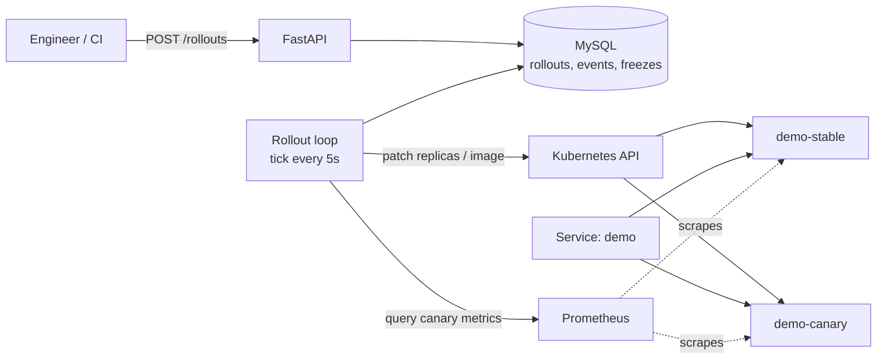

# canary-controller

A progressive delivery controller for Kubernetes. It rolls a new version out in steps
(25% → 50% → 100%), checks the canary's error rate and latency in Prometheus after each
step, and **rolls back automatically** when a threshold is crossed.

Built in Python (FastAPI + SQLAlchemy) with MySQL holding rollout state, so the
controller can crash and pick up where it left off.

## Architecture



**State machine** (`src/canary/engine.py`):

```
pending ──(no freeze)──> progressing ──(every step healthy)──> succeeded
                              │
                              └──(a step fails analysis)──> rolled_back
pending / progressing ──(abort API)──> aborted
```

| Module | Responsibility |
|---|---|
| `policy.py` | Validated rollout policy: steps and thresholds |
| `engine.py` | State machine: one transition per tick, persisted in MySQL |
| `analysis.py` | Pure function: metric readings + thresholds → verdict |
| `metrics.py` | PromQL queries for canary error rate and p95 latency |
| `router.py` | Traffic shifting: replica split between stable and canary Deployments |
| `api.py` | REST API and the background loop |

## Quickstart (no cluster needed)

```bash
make up        # venv + MySQL on :3307
make test      # unit + API tests (SQLite)
make test-mysql
make run       # API on :8020, logs actions instead of touching a cluster
```

Then open http://127.0.0.1:8020/docs.

## Full demo on kind

Needs `docker`, `kind` (`brew install kind`) and `kubectl`.

```bash
make cluster images deploy
make prometheus-forward      # terminal 2, leave running
make demo-run                # terminal 3: the controller

make rollout-good            # v2 walks 25% → 50% → 100% and is promoted
make rollout-bad             # v2-bad (30% errors) is rolled back at the first step
make rollout-slow            # v2-slow (+150 ms) is under the 500 ms ceiling, but slower
                             # than stable, so it is rolled back too
make status
```

Real output from a run on kind:

```text
$ make rollout-good
[   4s] step         step 0: canary at 25%      | demo-stable=3 demo-canary=1
[  65s] analysis     step 0 (25%): healthy      | demo-stable=2 demo-canary=2
[ 124s] analysis     step 1 (50%): healthy      | demo-stable=0 demo-canary=4
[ 185s] analysis     step 2 (100%): healthy     | demo-stable=4 demo-canary=0
[ 185s] succeeded    all steps healthy
FINAL: succeeded - all steps healthy

$ make rollout-bad
[   4s] step         step 0: canary at 25%                          | demo-stable=3 demo-canary=1
[  65s] analysis     step 0 (25%): error_rate=0.3074 exceeds max 0.05 | demo-stable=4 demo-canary=0
[  65s] rolled_back  error_rate=0.3074 exceeds max 0.05
FINAL: rolled_back - error_rate=0.3074 exceeds max 0.05
```

The bad version only ever reached 1 of 4 pods, and was gone 65 seconds after it started.

```text
$ make rollout-slow
[   2s] step         step 0: canary at 25%                                   | demo-stable=3 demo-canary=1
[  63s] analysis     step 0 (25%): p95_latency_ms=242.5 is +237.8 vs stable (4.75), allowed +100
[  63s] rolled_back  p95_latency_ms=242.5 is +237.8 vs stable (4.75), allowed +100
```

242 ms is well under the 500 ms ceiling, so a fixed-threshold check would have promoted
it. It is caught only because it is compared against what's running now.

## Rollout policy

Each check can have a **hard ceiling** (`max`), a **limit relative to stable**
(`max_over_stable`, in the metric's own units), or both:

```yaml
min_requests: 50                  # don't judge a canary on a handful of requests
max_wait_for_traffic_seconds: 120 # wait this long for them, then roll back
thresholds:
  - { metric: error_rate, max: 0.05, max_over_stable: 0.01 }    # ≤5%, ≤1 point worse than stable
  - { metric: p95_latency_ms, max: 500, max_over_stable: 100 }  # ≤500 ms, ≤100 ms slower
```

How a step is judged, once its pause is over:

1. **Enough traffic?** Fewer than `min_requests` canary requests in the window: wait
   (logged once), and roll back if traffic never arrives within
   `max_wait_for_traffic_seconds`.
2. **Baseline.** If stable also has enough traffic, its readings become the new baseline
   and are saved on the rollout. If not (at the 100% step stable has no pods), the last
   saved baseline is used.
3. **Checks.** Every threshold must pass. Missing data, or no baseline for a
   `max_over_stable` check, counts as a failure.

### What the first real run caught

The unit tests all passed, yet the first run on a real cluster rolled back a **healthy**
release. Two separate causes:

1. **A PromQL edge case.** The error rate is `5xx requests / all requests`. A version
   that has never returned a 5xx has no 5xx series in Prometheus at all, so the query
   returned nothing instead of `0`. The controller fails closed on missing data, so it
   rolled back. Fix: `(errors or vector(0)) / total`. Regression test in
   `tests/test_metrics.py`.
2. **The load generator stalled.** It was one `curl` loop with no timeout. When stable
   pods were scaled away, a request hung on a dead connection and traffic dropped to
   zero, so the canary had no data at 100%. Fix: four parallel loops with request
   timeouts.

In both cases failing closed was the right behaviour. A canary the controller can't
measure should not be promoted.

## API

| Method | Path | Purpose |
|---|---|---|
| `POST` | `/rollouts` | Start a rollout `{app, image, policy?}`. Returns 409 if the app already has one active |
| `GET` | `/rollouts?app_name=` | List recent rollouts |
| `GET` | `/rollouts/{id}` | Rollout details and its event log |
| `POST` | `/rollouts/{id}/abort` | Stop now and roll back |
| `PUT` / `DELETE` | `/freezes/{app}` | Start or end a deploy freeze (new rollouts wait) |
| `GET` | `/freezes` | List active freezes |

## Design decisions and trade-offs

- **State lives in MySQL, not memory.** Every tick re-reads the rollout, makes one
  transition and commits. A controller restart loses nothing
  (`test_resumes_after_controller_restart`).
- **Router calls are idempotent.** They set absolute desired state ("canary = 2
  replicas"), not deltas. A crash between changing the cluster and committing is safe
  because the next tick repeats the same call.
- **The database enforces one active rollout per app.** `active_app` has a unique index
  and is set to NULL when a rollout finishes. Two racing `POST`s cannot both win, which
  an app-level "check then insert" would allow.
- **Safe to run several replicas.** The loop locks rows with
  `SELECT … FOR UPDATE SKIP LOCKED`, so two controllers never work on the same rollout.
- **Fails closed.** No metric data counts as unhealthy. A canary we can't see is not a
  canary we trust.
- **Compared against stable, not just fixed limits.** A fixed limit has to be loose
  enough for every app on its worst day, so it misses real regressions. Comparing with
  the version running right now catches "worse than before" whatever the absolute level.
  The ceiling stays as a backstop in case stable itself is unhealthy.
- **Differences, not ratios.** `max_over_stable` is `canary - stable`. A ratio breaks when
  stable is at 0 (any error at all is "infinitely worse"), and a 3 ms → 6 ms "100%
  regression" doesn't matter to anyone.
- **Low traffic means wait, not pass.** 0 errors out of 3 requests proves nothing.
  Stable readings below `min_requests` are also ignored as a baseline.
- **Traffic split = replica ratio.** Simple and needs no service mesh, but coarse:
  4 replicas only give 25% steps. See the roadmap for weighted routing.
- **Failures are isolated.** An exception on one rollout is logged and rolled back
  without stalling the others (`test_one_failing_rollout_does_not_block_others`).

## Roadmap

- [x] **Week 1:** State machine, policy, MySQL persistence, API, unit tests, CI
- [x] **Week 2:** Run the full kind demo end to end (good rollout promoted, bad one
      rolled back); fixed two bugs it surfaced
- [ ] **Week 2 polish:** Record a GIF of `make rollout-bad` for the top of this README
- [x] **Week 3:** Compare canary against stable (with a saved baseline for the 100%
      step); wait for a minimum request count before judging; `make rollout-slow` demo
- [ ] **Week 4:** Alembic migrations; Prometheus metrics for the controller itself
      (rollouts by outcome, time to rollback)
- [ ] **Week 5:** Weighted traffic with Gateway API `HTTPRoute` for finer splits
- [ ] **Week 6:** Slack/webhook notifications; a GitHub Action that starts a rollout after
      merge
- [ ] **Stretch:** LLM summary of why a rollout failed (metrics + recent log lines),
      added to the rollback event
- [ ] **Stretch:** Deploy the controller itself to EKS with RDS MySQL
