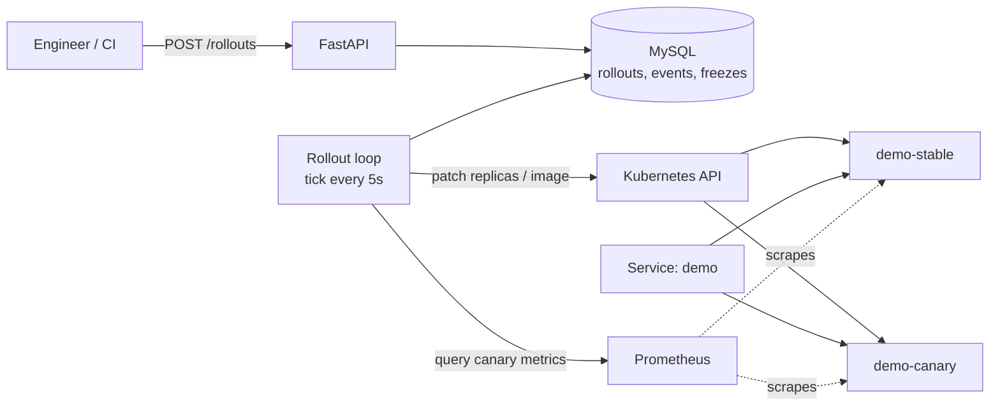

# canary-controller

A progressive delivery controller for Kubernetes. It rolls a new version out in steps
(25% → 50% → 100%), checks the canary's error rate and latency in Prometheus after each
step, and **rolls back automatically** when a threshold is crossed.

Built in Python (FastAPI + SQLAlchemy) with MySQL holding rollout state, so the
controller can crash and pick up where it left off.

## Architecture



**State machine** (`src/canary/engine.py`):

```
pending ──(no freeze)──> progressing ──(every step healthy)──> succeeded
                              │
                              └──(a step fails analysis)──> rolled_back
pending / progressing ──(abort API)──> aborted
```

| Module | Responsibility |
|---|---|
| `policy.py` | Validated rollout policy: steps and thresholds |
| `engine.py` | State machine: one transition per tick, persisted in MySQL |
| `analysis.py` | Pure function: metric readings + thresholds → verdict |
| `metrics.py` | PromQL queries for canary error rate and p95 latency |
| `router.py` | Traffic shifting: replica split between stable and canary Deployments |
| `api.py` | REST API and the background loop |

## Quickstart (no cluster needed)

```bash
make up        # venv + MySQL on :3307
make test      # unit + API tests (SQLite)
make test-mysql
make run       # API on :8020, logs actions instead of touching a cluster
```

Then open http://127.0.0.1:8020/docs.

## Full demo on kind

Needs `docker`, `kind` (`brew install kind`) and `kubectl`.

```bash
make cluster images deploy
make prometheus-forward      # terminal 2, leave running
make demo-run                # terminal 3: the controller

make rollout-good            # v2 walks 25% → 50% → 100% and is promoted
make rollout-bad             # v2-bad (30% errors) is rolled back at the first step
make status
```

## API

| Method | Path | Purpose |
|---|---|---|
| `POST` | `/rollouts` | Start a rollout `{app, image, policy?}`. Returns 409 if the app already has one active |
| `GET` | `/rollouts?app_name=` | List recent rollouts |
| `GET` | `/rollouts/{id}` | Rollout details and its event log |
| `POST` | `/rollouts/{id}/abort` | Stop now and roll back |
| `PUT` / `DELETE` | `/freezes/{app}` | Start or end a deploy freeze (new rollouts wait) |
| `GET` | `/freezes` | List active freezes |

## Design decisions and trade-offs

- **State lives in MySQL, not memory.** Every tick re-reads the rollout, makes one
  transition and commits. A controller restart loses nothing
  (`test_resumes_after_controller_restart`).
- **Router calls are idempotent.** They set absolute desired state ("canary = 2
  replicas"), not deltas. A crash between changing the cluster and committing is safe
  because the next tick repeats the same call.
- **The database enforces one active rollout per app.** `active_app` has a unique index
  and is set to NULL when a rollout finishes. Two racing `POST`s cannot both win, which
  an app-level "check then insert" would allow.
- **Safe to run several replicas.** The loop locks rows with
  `SELECT … FOR UPDATE SKIP LOCKED`, so two controllers never work on the same rollout.
- **Fails closed.** No metric data counts as unhealthy. A canary we can't see is not a
  canary we trust.
- **Traffic split = replica ratio.** Simple and needs no service mesh, but coarse:
  4 replicas only give 25% steps. See the roadmap for weighted routing.
- **Failures are isolated.** An exception on one rollout is logged and rolled back
  without stalling the others (`test_one_failing_rollout_does_not_block_others`).

## Roadmap

- [x] **Week 1:** State machine, policy, MySQL persistence, API, unit tests, CI
- [ ] **Week 2:** Run the full kind demo end to end and record a GIF of an auto-rollback
- [ ] **Week 3:** Compare canary against stable instead of only fixed thresholds; add a
      minimum request count before judging
- [ ] **Week 4:** Alembic migrations; Prometheus metrics for the controller itself
      (rollouts by outcome, time to rollback)
- [ ] **Week 5:** Weighted traffic with Gateway API `HTTPRoute` for finer splits
- [ ] **Week 6:** Slack/webhook notifications; a GitHub Action that starts a rollout after
      merge
- [ ] **Stretch:** LLM summary of why a rollout failed (metrics + recent log lines),
      added to the rollback event
- [ ] **Stretch:** Deploy the controller itself to EKS with RDS MySQL
