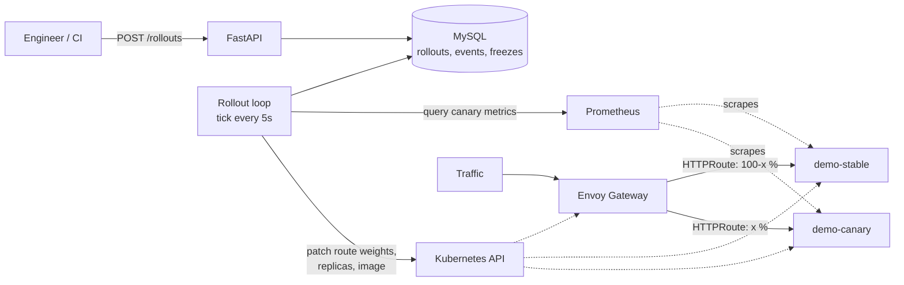

# canary-controller

A progressive delivery controller for Kubernetes. It rolls a new version out in steps
(e.g. 5% → 25% → 50% → 100%), checks the canary's error rate and latency in Prometheus after each
step, and **rolls back automatically** when a threshold is crossed.

Built in Python (FastAPI + SQLAlchemy) with MySQL holding rollout state, so the
controller can crash and pick up where it left off.

**Running it yourself:** [docs/RUNNING.md](docs/RUNNING.md) is a step-by-step guide.
It covers prerequisites, the three ways to run it, things to try, settings,
troubleshooting and cleanup.

## Architecture



Two routing modes (`CANARY_ROUTER`):

| Mode | How traffic is split | Smallest step | Rollback |
|---|---|---|---|
| `gateway` | Gateway API `HTTPRoute` weights | any % (e.g. 5%) | instant route flip; stable never scaled down |
| `replicas` | pod ratio behind one Service | 1 pod (25% with 4 pods) | stable scales back up |
| `log` | nothing; logs actions | n/a | n/a |

**State machine** (`src/canary/engine.py`):

```
pending ──(no freeze)──> progressing ──(every step healthy)──> promoting ──> succeeded
                              │
                              └──(a step fails, or pods never ready)──> rolled_back
pending / progressing ──(abort API)──> aborted
```

Each step: **wait for canary pods** → move traffic → pause → check traffic volume →
analyse. `promoting` waits for stable to run the new image before traffic moves back.

| Module | Responsibility |
|---|---|
| `policy.py` | Validated rollout policy: steps and thresholds |
| `engine.py` | State machine: one transition per tick, persisted in MySQL |
| `analysis.py` | Pure function: metric readings + thresholds → verdict |
| `metrics.py` | PromQL queries for canary error rate and p95 latency |
| `router.py` | Traffic shifting: `GatewayRouter` (route weights) or `ReplicaRouter` (pod ratio) |
| `api.py` | REST API and the background loop |
| `telemetry.py` | Prometheus metrics about the controller itself |
| `notify.py` | Slack/webhook alerts: outbox rows + dispatcher with retries |
| `cli.py` | `canary-rollout`: start a rollout and wait for it (CI) |
| `db.py`, `migrations/` | Connections, Alembic migrations, startup schema check |

## Quickstart (no cluster needed)

The short version. [docs/RUNNING.md](docs/RUNNING.md) has the full walkthrough.

```bash
make up        # venv + MySQL on :3307 + migrations
make test      # unit + API tests (SQLite)
make test-mysql
make run       # API on :8020, logs actions instead of touching a cluster
```

Then open http://127.0.0.1:8020/docs.

## Full demo on kind

Needs `docker`, `kind` (`brew install kind`) and `kubectl`.

```bash
make cluster images deploy
make prometheus-forward      # terminal 2, leave running
make demo-run                # terminal 3: the controller

make rollout-good            # v2 walks 25% → 50% → 100% and is promoted
make rollout-bad             # v2-bad (30% errors) is rolled back at the first step
make rollout-slow            # v2-slow (+150 ms) is under the 500 ms ceiling, but slower
                             # than stable, so it is rolled back too
make status
```

Real output from a run on kind:

```text
$ make rollout-good
[   4s] step         step 0: canary at 25%      | demo-stable=3 demo-canary=1
[  65s] analysis     step 0 (25%): healthy      | demo-stable=2 demo-canary=2
[ 124s] analysis     step 1 (50%): healthy      | demo-stable=0 demo-canary=4
[ 185s] analysis     step 2 (100%): healthy     | demo-stable=4 demo-canary=0
[ 185s] succeeded    all steps healthy
FINAL: succeeded - all steps healthy

$ make rollout-bad
[   4s] step         step 0: canary at 25%                          | demo-stable=3 demo-canary=1
[  65s] analysis     step 0 (25%): error_rate=0.3074 exceeds max 0.05 | demo-stable=4 demo-canary=0
[  65s] rolled_back  error_rate=0.3074 exceeds max 0.05
FINAL: rolled_back - error_rate=0.3074 exceeds max 0.05
```

The bad version only ever reached 1 of 4 pods, and was gone 65 seconds after it started.

```text
$ make rollout-slow
[   2s] step         step 0: canary at 25%                                   | demo-stable=3 demo-canary=1
[  63s] analysis     step 0 (25%): p95_latency_ms=242.5 is +237.8 vs stable (4.75), allowed +100
[  63s] rolled_back  p95_latency_ms=242.5 is +237.8 vs stable (4.75), allowed +100
```

242 ms is well under the 500 ms ceiling, so a fixed-threshold check would have promoted
it. It is caught only because it is compared against what's running now.

### Weighted routing (Gateway API)

```bash
make gateway-install     # Envoy Gateway v1.9.3 into the kind cluster
make gateway-deploy      # Gateway + HTTPRoute; load generator goes through Envoy
make demo-run-gateway    # controller with CANARY_ROUTER=gateway

make rollout-gateway-bad   # caught at 5% of traffic
make rollout-gateway-good  # 5% -> 25% -> 50% -> 100%, promoted
```

Real output (`| deployments | route weights`):

```text
$ make rollout-gateway-bad
[   4s] waiting_for_pods step 0: canary pods starting (5% next)  | stable=4 canary=1 | route stable:100 canary:0
[   8s] step         step 0: canary at 5%                        | stable=4 canary=1 | route stable:95 canary:5
[  69s] analysis     step 0 (5%): error_rate=0.3222 exceeds max 0.05 ...
[  69s] rolled_back  ...                                         | stable=4 canary=0 | route stable:100 canary:0

$ make rollout-gateway-good
[  10s] step         step 0: canary at 5%      | stable=4 canary=1 | route stable:95 canary:5
[  71s] step         step 1: canary at 25%     | stable=4 canary=1 | route stable:75 canary:25
[ 131s] waiting_for_pods step 2: canary pods starting (50% next)
[ 137s] step         step 2: canary at 50%     | stable=4 canary=2 | route stable:50 canary:50
[ 202s] step         step 3: canary at 100%    | stable=4 canary=4 | route stable:0 canary:100
[ 261s] succeeded    all steps healthy         | stable=4 canary=0 | route stable:100 canary:0
```

- **The 5% is real.** Measured in Prometheus at the moment of analysis, the canary got
  4.92–5.13% of requests (60/45/30 s windows), not just 5 in a config field.
- **Stable stays at 4 pods throughout**, so rollback is one route change. In replica mode,
  rolling back at 100% has to wait for stable pods to start again.
- **Traffic never gets ahead of capacity.** Before 50%, the controller waited 6 s for a
  second canary pod instead of sending half the users to one.
- **Promotion is a real state.** Rolling `v2 -> v1` live: the canary kept 100% of traffic
  while stable rolled 4 pods to `v1` (5 s), and only then did the route flip back.

## Rollout policy

Each check can have a **hard ceiling** (`max`), a **limit relative to stable**
(`max_over_stable`, in the metric's own units), or both:

```yaml
min_requests: 50                  # don't judge a canary on a handful of requests
max_wait_for_traffic_seconds: 120 # wait this long for them, then roll back
thresholds:
  - { metric: error_rate, max: 0.05, max_over_stable: 0.01 }    # ≤5%, ≤1 point worse than stable
  - { metric: p95_latency_ms, max: 500, max_over_stable: 100 }  # ≤500 ms, ≤100 ms slower
```

How a step is judged, once its pause is over:

1. **Enough traffic?** Fewer than `min_requests` canary requests in the window: wait
   (logged once), and roll back if traffic never arrives within
   `max_wait_for_traffic_seconds`.
2. **Baseline.** Stable is snapshotted just before step 0 moves any traffic, while it
   still serves everyone. At later steps, if stable has enough traffic its readings
   replace the baseline; if not (stable gets no traffic at 100%), the last saved one is
   used.
3. **Checks.** Every threshold must pass. Missing data, or no baseline for a
   `max_over_stable` check, counts as a failure.

### What the first real run caught

The unit tests all passed, yet the first run on a real cluster rolled back a **healthy**
release. Two separate causes:

1. **A PromQL edge case.** The error rate is `5xx requests / all requests`. A version
   that has never returned a 5xx has no 5xx series in Prometheus at all, so the query
   returned nothing instead of `0`. The controller fails closed on missing data, so it
   rolled back. Fix: `(errors or vector(0)) / total`. Regression test in
   `tests/test_metrics.py`.
2. **The load generator stalled.** It was one `curl` loop with no timeout. When stable
   pods were scaled away, a request hung on a dead connection and traffic dropped to
   zero, so the canary had no data at 100%. Fix: four parallel loops with request
   timeouts.

In both cases failing closed was the right behaviour. A canary the controller can't
measure should not be promoted.

## API

| Method | Path | Purpose |
|---|---|---|
| `POST` | `/rollouts` | Start a rollout `{app, image, policy?}`. Returns 409 if the app already has one active |
| `GET` | `/rollouts?app_name=` | List recent rollouts |
| `GET` | `/rollouts/{id}` | Rollout details and its event log |
| `POST` | `/rollouts/{id}/abort` | Stop now and roll back |
| `PUT` / `DELETE` | `/freezes/{app}` | Start or end a deploy freeze (new rollouts wait) |
| `GET` | `/freezes` | List active freezes |
| `GET` | `/rollouts/{id}/notifications` | Delivery status of that rollout's Slack/webhook alerts |
| `GET` | `/metrics` | Prometheus metrics about the controller itself (below) |

Set `CANARY_API_TOKEN` and every `POST`/`PUT`/`DELETE` needs
`Authorization: Bearer <token>` (compared in constant time). Reads stay open.

## Notifications

```bash
CANARY_SLACK_WEBHOOK_URL=https://hooks.slack.com/services/...   # Slack incoming webhook
CANARY_WEBHOOK_URLS=https://a.example.com/hook,https://b...      # generic JSON webhooks
```

Sent when a rollout **starts** (first traffic), **succeeds**, **rolls back** or is
**aborted**:

```text
:rotating_light: *demo* `demo-app:v2-bad` rolled back (rollout 7)
> error_rate=0.2812 exceeds max 0.05; ...
```

Generic webhooks get JSON (`event`, `at`, `rollout{id, app, image, state, reason, weight}`)
plus a `delivery_id`, which is also in the `X-Canary-Delivery` header.

**Delivery uses a transactional outbox.** The engine never makes HTTP calls. It writes a
`notifications` row per (event, sink) in the **same transaction** as the state change,
and a dispatcher in the controller loop delivers due rows:

- **A crash can't lose an alert.** If the rollback committed, so did its notification.
- **A Slack outage can't slow or break a rollout.** Failures retry with exponential
  backoff (10 s, 20 s, 40 s … capped at 10 min), and give up after 6 attempts.
- **At least once.** A crash between sending and recording "sent" means a resend, so
  receivers should dedupe on `delivery_id`.
- **One row per sink.** Retrying a failed Slack post never re-sends to a webhook that
  already succeeded.
- **Known limit:** rows are delivered in id order, but a retried "started" can arrive
  after the "rolled_back" that followed it. Receivers should go by `at`, not arrival order.

Try it locally with a stand-in receiver that fails its first two requests:

```bash
python scripts/webhook_receiver.py 8090 2
CANARY_WEBHOOK_URLS=http://127.0.0.1:8090/hook CANARY_SLACK_WEBHOOK_URL=http://127.0.0.1:8090/slack make demo-run-gateway
```

From a real run: both "started" deliveries got a 503, were retried 10 s later and
delivered once each (`GET /rollouts/7/notifications` shows `sent`, `attempts=1`).

## CI: roll out after merge

`canary-rollout` starts a rollout and blocks until it finishes:

```bash
canary-rollout --api https://canary.example.com --app demo --image demo-app:abc123 \
  [--policy policies/gateway.yaml] [--timeout 1800] [--abort-on-timeout]
```

| Exit | Meaning |
|---|---|
| 0 | succeeded |
| 1 | rolled back or aborted |
| 2 | couldn't tell: timeout, API unreachable, or another rollout already active |

It retries dropped connections and 5xx responses, and prints `::error::` lines that
GitHub Actions shows as annotations.

**GitHub Action** (`.github/actions/canary-rollout`):

```yaml
- uses: Awesomeav23/canary-controller/.github/actions/canary-rollout@main
  with:
    api-url: ${{ vars.CANARY_API_URL }}
    token: ${{ secrets.CANARY_API_TOKEN }}
    app: demo
    image: ghcr.io/you/demo-app:${{ github.sha }}
```

Outputs: `rollout-id`, `state`, `reason`. `.github/workflows/deploy.yml` runs it after CI
passes on `main`. It is skipped until `CANARY_API_URL` is set, and it never cancels a
rollout in flight (a concurrency group per app).

**How it's tested:** the `action-e2e` CI job starts a real controller (MySQL, migrations,
API token) inside the runner and runs the real Action against it. There's no Prometheus
there, so the controller must fail closed. The job checks that the Action reports
`rolled_back`, fails its step, and that writes without the token get 401. `actionlint`
checks every workflow, including inputs passed to the local Action.

## Controller metrics

The controller is itself a production service, so it reports on itself at `/metrics`:

| Metric | What it answers |
|---|---|
| `canary_rollouts_finished_total{app, outcome}` | How many releases succeed, roll back, or are aborted? |
| `canary_rollout_duration_seconds{outcome}` | How long rollouts take. `outcome="rolled_back"` is **time to rollback** |
| `canary_analyses_total{app, result}` | Healthy / unhealthy / waiting-for-traffic checks |
| `canary_active_rollouts` | Rollouts in flight (updated each tick, so up to 5 s behind) |
| `canary_advance_errors_total` | Unexpected exceptions. Above 0 means the controller needs attention |
| `canary_tick_duration_seconds` | How long each loop takes. Rising means the database or Prometheus is slow |

Duration is measured from the canary's **first traffic** (`started_at`), not from when
the rollout was requested, so time spent waiting on a deploy freeze doesn't count.

Metrics are recorded only **after** the database commit. If the transaction fails, the
metric doesn't move (`test_failed_transaction_records_nothing`).

Example queries are in `src/canary/telemetry.py`. From a real kind run:

```text
canary_rollouts_finished_total{app="demo",outcome="rolled_back"} 1.0
canary_rollouts_finished_total{app="demo",outcome="succeeded"} 1.0
canary_rollout_duration_seconds_sum{outcome="rolled_back"} 60.40955
canary_rollout_duration_seconds_sum{outcome="succeeded"} 180.752451
canary_analyses_total{app="demo",result="healthy"} 3.0
canary_analyses_total{app="demo",result="unhealthy"} 1.0
```

## Database migrations

Schema changes ship as Alembic migrations in `src/canary/migrations/versions/`:

| Revision | Change |
|---|---|
| `0001` | Initial schema: rollouts, event log, deploy freezes |
| `0002` | `rollouts.baseline`: last trusted stable readings (Week 3) |
| `0003` | `rollouts.started_at`, backfilled from each rollout's first `step` event (Week 4) |

```bash
make migrate                       # apply everything
make migration m="add foo column"  # draft a new one from model changes, then review it
```

- **The app checks the schema but never migrates it.** On startup it compares the
  database's revision with the code's and refuses to start if they differ
  (`database schema is at 0002, code expects 0003: run make migrate`). Migrating on startup
  would let several replicas race to run the same migration. In production this would run
  as a separate deploy step, such as a Kubernetes Job.
- **Additive changes first.** `0002` and `0003` only add nullable columns, so the old code
  keeps working while the migration runs. Old and new versions run side by side during a
  rollout, which this controller of all things should respect.
- **The schema is checked against the models in CI.** `tests/test_migrations.py` builds
  the schema from migrations and fails if it differs from the models at all. It also
  downgrades to nothing and back, and tests the `started_at` backfill.
- **Tested on MySQL, not just SQLite.** The MySQL CI job caught a downgrade bug SQLite
  allowed: dropping an index a foreign key still uses (MySQL error 1553).

## Design decisions and trade-offs

- **State lives in MySQL, not memory.** Every tick re-reads the rollout, makes one
  transition and commits. A controller restart loses nothing
  (`test_resumes_after_controller_restart`).
- **Router calls are idempotent.** They set absolute desired state ("canary = 2
  replicas"), not deltas. A crash between changing the cluster and committing is safe
  because the next tick repeats the same call.
- **The database enforces one active rollout per app.** `active_app` has a unique index
  and is set to NULL when a rollout finishes. Two racing `POST`s cannot both win, which
  an app-level "check then insert" would allow.
- **Safe to run several replicas.** The loop locks rows with
  `SELECT … FOR UPDATE SKIP LOCKED`, so two controllers never work on the same rollout.
- **Fails closed.** No metric data counts as unhealthy. A canary we can't see is not a
  canary we trust.
- **Compared against stable, not just fixed limits.** A fixed limit has to be loose
  enough for every app on its worst day, so it misses real regressions. Comparing with
  the version running right now catches "worse than before" whatever the absolute level.
  The ceiling stays as a backstop in case stable itself is unhealthy.
- **Differences, not ratios.** `max_over_stable` is `canary - stable`. A ratio breaks when
  stable is at 0 (any error at all is "infinitely worse"), and a 3 ms → 6 ms "100%
  regression" doesn't matter to anyone.
- **Low traffic means wait, not pass.** 0 errors out of 3 requests proves nothing.
  Stable readings below `min_requests` are also ignored as a baseline.
- **Two routers behind one interface.** `replicas` needs nothing but Kubernetes, but its
  smallest step is one pod. `gateway` splits by exact weight but needs a Gateway API
  implementation. The engine doesn't know which it has.
- **Never route users to pods that can't serve.** `set_weight` and `promote` return
  "not yet" until the target pods are ready, and the engine retries next tick. A step's
  pause counts from when traffic actually moved (`traffic_shifted_at`), not from when
  the step began. Pods that never get ready (bad image, crash loop) roll back after
  `pod_ready_timeout_seconds`.
- **Trade-off: rollback speed vs. cost.** Gateway mode keeps stable at full size during
  the whole rollout. That costs extra pods (up to 2x at the 100% step), and in return
  rollback never waits for pods to start.
- **Abort is refused while promoting.** By then stable is partway through rolling to the
  verified image. "Rolling back" would be a third version change, not a safe stop.
- **Blind spot.** Analysis uses the app's own metrics, so errors produced by Envoy itself
  (e.g. 503 with no healthy upstream) aren't counted. Next step: also read Envoy's
  per-backend metrics.
- **Failures are isolated.** An exception on one rollout is logged and rolled back
  without stalling the others (`test_one_failing_rollout_does_not_block_others`).
- **Baseline before the first shift.** Found on kind: a one-step 100% policy never saw
  stable traffic, so its `max_over_stable` checks could never pass. Stable is now
  snapshotted before step 0 (`test_baseline_captured_before_first_traffic_shift`).
- **CI waits on the controller and doesn't duplicate it.** The Action holds no rollout
  logic. It starts a rollout and reports what the controller decided, so a cancelled CI
  job can't leave a half-finished rollout behind, because the controller owns it.

## Roadmap

- [x] **Week 1:** State machine, policy, MySQL persistence, API, unit tests, CI
- [x] **Week 2:** Run the full kind demo end to end (good rollout promoted, bad one
      rolled back); fixed two bugs it surfaced
- [ ] **Week 2 polish:** Record a GIF of `make rollout-bad` for the top of this README
- [x] **Week 3:** Compare canary against stable (with a saved baseline for the 100%
      step); wait for a minimum request count before judging; `make rollout-slow` demo
- [x] **Week 4:** Alembic migrations (schema checked in CI, startup schema check);
      Prometheus metrics for the controller itself (outcomes, time to rollback)
- [x] **Week 5:** Weighted traffic with Gateway API `HTTPRoute` (Envoy Gateway): 5%
      steps, instant rollback, waits for pod readiness, `promoting` state
- [x] **Week 6:** Slack/webhook notifications (transactional outbox, retries); API token;
      `canary-rollout` CLI + GitHub Action, tested end to end in CI
- [ ] **Stretch:** LLM summary of why a rollout failed (metrics + recent log lines),
      added to the rollback event
- [ ] **Next:** Run the controller itself in the cluster: container image, Deployment,
      ServiceAccount + RBAC (patch Deployments and HTTPRoutes), migration Job. Today it
      runs on the host against kind ([what runs where](docs/RUNNING.md#what-runs-where))
- [ ] **Stretch:** Deploy to a cloud cluster: EKS with RDS MySQL
